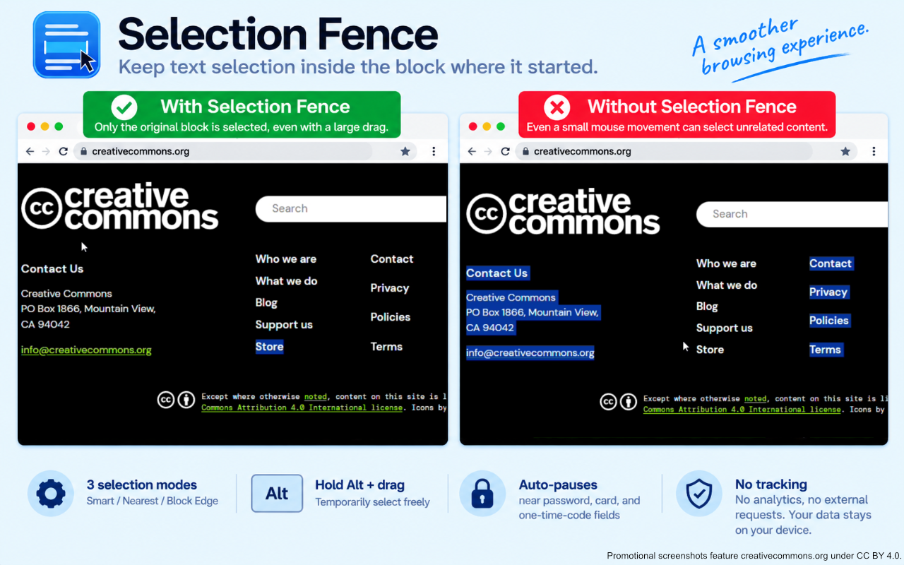

# Selection Fence



Selection Fence is a lightweight Chrome extension that prevents accidental text selections from jumping into unrelated parts of a web page.

Selection Fence は、文字をドラッグ選択したときに、選択範囲が意図せず別の段落・見出し・サイドバーなどへ広がるのを防ぐ Chrome 拡張機能です。

## Features / 主な機能

- Keeps text selection within the block where the drag started.
- Smart / Nearest / Block Edge selection modes.
- Hold **Alt** while starting a drag to temporarily bypass the restriction and select across multiple blocks.
- Automatically pauses near visible password, credit-card, and one-time-code fields.
- No analytics.
- No advertising.
- No external network requests.
- No page content, selected text, or form input values are persistently stored or transmitted.

- 選択を開始した文字ブロック内に選択範囲を留めます。
- 「自動 / 最寄り文字 / ブロック端」の3モードを選択できます。
- **Alt キーを押しながらドラッグを開始**すると、一時的に制限を解除して複数ブロックを選択できます。
- 表示中のパスワード・カード・ワンタイムコード入力欄の周辺では自動休止します。
- 解析なし。
- 広告なし。
- 外部通信なし。
- ページ本文、選択文字列、フォーム入力値を永続保存・外部送信しません。

## Selection modes / 選択モード

- **Smart / 自動（推奨）**  
  Small pointer movements use the nearest text position; larger movements stop at the block edge.  
  少しのずれはマウスに近い文字位置で止め、大きく離れた場合はブロック端で止めます。

- **Nearest / 最寄り文字**  
  Always stops at the text position closest to the pointer within the starting block.  
  常に開始ブロック内でマウスに最も近い文字位置に止めます。

- **Block Edge / ブロック端**  
  Stops at the beginning or end of the text block where the selection started.  
  選択を開始した文字ブロックの先頭または末尾で止めます。

The difference between modes is most noticeable when selecting multi-line text.

モードの違いは、複数行の文章を選択するときに分かりやすく現れます。

## Alt bypass / Alt キーによる一時解除

Hold **Alt** while starting a drag to temporarily disable Selection Fence and select across multiple blocks.

**Alt キーを押しながらドラッグを開始**すると、一時的に Selection Fence の制限を解除して、複数のブロックをまたいで選択できます。

## Sensitive input fields / 機密入力欄周辺での自動休止

For privacy and safety, Selection Fence automatically pauses its selection-limiting behavior near visible password, credit-card, and one-time-code fields.

It only checks field type, `autocomplete` attributes, visibility, and position. It does not read the values entered into those fields.

プライバシーと安全性に配慮し、表示中のパスワード・カード・ワンタイムコード入力欄の周辺では、Selection Fence の選択制限を自動的に休止します。

判定には入力欄の種類、`autocomplete` 属性、表示状態、位置のみを使用し、入力された値そのものは読み取りません。

## Privacy / プライバシー

Selection Fence processes pointer interaction and selection-related DOM information locally in the browser only as needed to provide its function.

The extension stores only the selected behavior mode (`smart`, `nearest`, or `block`) and the diagnostic logging preference in `chrome.storage.local`.

It does not transmit page contents, selected text, browsing history, or form input values to external servers.

Selection Fence は、機能提供に必要な範囲で、マウス操作情報および文字選択に関係する DOM 情報をブラウザ内で一時的に処理します。

保存するのは、選択した動作モード（`smart` / `nearest` / `block`）と診断ログのオン・オフ設定のみで、`chrome.storage.local` に保存されます。

ページ本文、選択文字列、閲覧履歴、フォーム入力値を外部サーバーへ送信しません。

See [PRIVACY_POLICY.md](./PRIVACY_POLICY.md) for details.

詳細は [PRIVACY_POLICY.md](./PRIVACY_POLICY.md) をご覧ください。

## Diagnostic logs / 診断ログ

Diagnostic logging is off by default. To investigate an intermittent failure:

1. Open the extension popup on the affected page, expand **Troubleshooting**, enable **Record diagnostic logs**, and wait for the recording confirmation.
2. Close the popup and reproduce the issue.
3. Open the popup on that same page, click **Show logs**, then **Copy**.

The last 200 events include click counts, bypass/pause reasons, activation retries,
DOM recovery results and selection corrections. Events contain only technical
metadata, never page text, selected text, URLs, element ids/classes or input values.
Logs stay in page memory, are erased when logging is disabled or the page is fully
reloaded, and are not uploaded or written to persistent storage. The on/off setting
persists across pages. Enable it before opening a page to investigate startup issues.
Double-click and modifier-key bypass behavior is unchanged.
The popup explains when recording is off or empty and keeps Copy disabled in those
cases. If the page cannot confirm a logging preference change, reload it before
reproducing the issue. `pointer.up`, `release.finalizing` and `release.completed`
record whether the selection endpoints are inside the starting block before and
after the final mouseup correction, without reading the selected text.
If a mousemove reports `buttons=0` before mouseup arrives, the extension preserves
the gesture for up to 250 ms instead of discarding its origin. A single timeout
finishes the selection if mouseup is missing. Diagnostics distinguish this wait,
its cancellation, and the timeout from a normal mouseup.
Only a primary-button mouseup finishes the gesture. Diagnostics record ignored
secondary-button releases as `release.ignored` and cancelled native drags as
`native_drag.cancelled`. Artificial blur/pagehide notifications do not release
the lock; native lifecycle events still clean it up.

診断ログは初期状態ではオフです。症状が出るページで拡張の設定画面の**「不具合の診断」**を開き、
**「診断ログを記録する」**をオンにし、**「記録中です」**と表示されたことを確認します。設定画面を閉じて操作し、症状が出たら、
ページを再読み込みせずに設定画面の**「ログを表示」→「コピー」**で採取してください。

クリック回数、制限の解除・休止理由、開始の再試行、DOM の復旧結果、選択の補正など、
直近200件をページのメモリ内に記録します。本文・選択文字・URL・要素の id/class・
入力値は含みません。ログはオフにするかページを完全に再読み込みすると消え、
永続保存・自動送信されません。オン・オフ設定は別のページにも引き継がれるため、
読み込み直後の症状を調べる際は、先にオンにしてからページを開いてください。
ダブルクリックや修飾キーによる制限解除の仕様は変えていません。
記録がオフ・空の場合は理由を表示し、コピーはできません。ページへの設定反映を確認できない場合は、
先にそのページを再読み込みしてください。`pointer.up`、`release.finalizing`、`release.completed` には、
クリックを離したときの最終補正の前後で選択の始点・終点が開始ブロック内にあるかを記録します。
この確認で選択文字列は読み取りません。
`mouseup` より先に `buttons=0` のマウス移動が届いた場合も、開始位置を捨てずに最大250ms待ちます。
通知が欠けた場合は一度だけ設定したタイムアウトで最終補正・解除を行います。
ログには待機・待機のキャンセル・タイムアウトを通常の `mouseup` と区別して記録します。
ドラッグを終了するのは左ボタンの `mouseup` です。その他のボタンを離した場合は `release.ignored`、
ページ側でキャンセルされたネイティブドラッグは `native_drag.cancelled` と記録します。
ページが人工的に発火した `blur`・`pagehide` では解除せず、ブラウザが通知した実際の状態変化で後片付けします。

## Development / 開発

The extension can be loaded directly from this folder; no build is required.
Browser regression tests require Node.js 22 or later:

拡張機能はこのフォルダから直接読み込めます。ビルドは不要です。
ブラウザでの回帰テストには Node.js 22 以降を使用します。

```sh
npm ci
npm run test:install
npm test
```

Tests load the actual extension in a separate headless Chromium profile and drag
text on a local page before loading completes. They cover startup retries,
invalid selection anchors, DOM replacement, quick drags, cleanup, and Alt bypass.
They also reproduce selection changes during mouseup and verify that finalization
cannot affect a subsequent drag. Separate Node tests delay the initial settings
read to check that newer preferences and recording acknowledgments take priority.
Input-order tests send trusted Chromium mouse events with `buttons=0` before
mouseup, including activation/pending states, missing mouseup, resumed movement,
new presses and Escape cancellation.
Cancellation tests distinguish element focus changes from actual window blur,
artificial lifecycle events from page navigation, and cancelled native drags from
accepted ones. They also cover secondary-button releases, obsolete cleanup tasks,
and invisible sensitive-field ancestors when the visibility API is unavailable.
Some tests control animation frames and caret lookups in the extension's isolated
world to reproduce transient failures deterministically; the DOM, Selection API,
and mouse interactions still run in Chromium. No personal browser profile is used.

テストは専用の Chromium に実際の拡張機能を読み込み、ローカルページの読み込み完了前に
文字をドラッグします。開始時の再試行、開始位置のずれ、DOM の置換、高速ドラッグ、
後片付け、Alt による解除を確認します。一部のテストでは一時的な失敗を確実に再現するため、
拡張機能の実行環境内で描画タイミングと文字位置の取得を制御します。
DOM・文字選択・マウス操作は Chromium で動作し、普段のブラウザプロファイルは使用しません。
要素のフォーカス解除とページ全体のフォーカス喪失、人工的な通知と実際のページ遷移、
キャンセルされたドラッグと成立したドラッグも区別してテストします。
左ボタン以外の解放、以前の操作の解除予約、可視性APIが使えない場合の非表示入力欄も確認します。

## Disclaimer / 免責事項

This software is provided **"AS IS"**, without warranty of any kind, express or implied. Use of this extension is at your own risk.

To the maximum extent permitted by applicable law, the author and copyright holder shall not be liable for any claim, damages, loss of data, loss of profits, service interruption, or other liability arising from or related to the use of, inability to use, or malfunction of this software.

Selection Fence is not a security product. Its sensitive-field auto-pause feature is a convenience feature and does not guarantee protection of confidential information.

このソフトウェアは **「現状のまま（AS IS）」** 提供され、明示・黙示を問わず、いかなる保証も行いません。利用は利用者自身の責任で行ってください。

適用法令で認められる最大限の範囲において、本ソフトウェアの使用、使用不能、不具合等に関連して生じた損害、データ損失、利益損失、サービス停止、その他の請求・責任について、作者および著作権者は責任を負いません。

Selection Fence はセキュリティ製品ではありません。機密入力欄周辺での自動休止機能は補助的な利便機能であり、機密情報の保護を保証するものではありません。

## License / ライセンス

MIT License.

See [LICENSE](./LICENSE).

MIT ライセンスで公開しています。詳細は [LICENSE](./LICENSE) をご覧ください。
